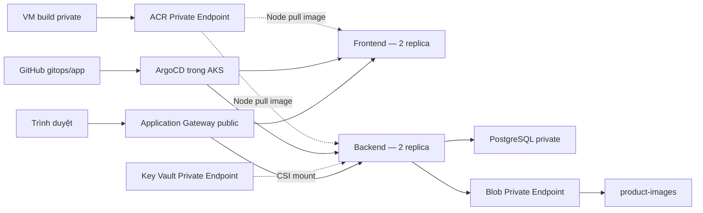

# AzureLab — triển khai Azure

Entry point: http://azurelab-b436d920.koreacentral.cloudapp.azure.com

Application Gateway public IP: `20.214.165.181`.

## Kiến trúc



VNet `10.20.0.0/16` tại Korea Central gồm subnet Application Gateway `10.20.0.0/24`, AKS `10.20.4.0/22`, Private Endpoint `10.20.8.0/24`, PostgreSQL `10.20.9.0/24` và quản trị `10.20.10.0/24`.

Terraform quản lý tài nguyên Azure và quyền RBAC. ArgoCD quản lý ứng dụng Kubernetes từ `gitops/app`. AGIC quản lý cấu hình định tuyến bên trong Application Gateway; Terraform bỏ qua các trường định tuyến mà AGIC sở hữu để tránh hai công cụ ghi đè nhau.

## Mã nguồn và image

Hai image đã build từ commit `0c0b974d92d4`:

- `acrazurelabb436d920.azurecr.io/azurelab-backend:0c0b974d92d4`
- `acrazurelabb436d920.azurecr.io/azurelab-frontend:0c0b974d92d4`

Mỗi Deployment có hai replica và required Pod anti-affinity theo hostname. Rolling update dùng `maxSurge: 0`, `maxUnavailable: 1` để không cần node thứ ba.

## Secret và danh tính

Không có giá trị secret trong Git. Key Vault giữ `postgres-admin-password`, `postgres-app-password`, `database-url`. Backend dùng ServiceAccount `azurelab/backend`, liên kết tới managed identity `id-backend-azurelab-dev` bằng Workload Identity.

Key Vault CSI mount `database-url` tại `/mnt/secrets-store/database-url`. Backend dùng `DATABASE_URL_FILE`; không tạo Kubernetes Secret chứa bản sao connection string. Sau khi thay secret DB, cần rollout backend để tạo lại connection pool.

Backend đăng nhập PostgreSQL bằng user `azurelab_app`; kết nối TLS `verify-full`. User này có quyền tạo bảng cho migration và sở hữu bảng của ứng dụng trong bản lab, không có quyền quản trị server.

Migration là ArgoCD Sync hook, wave -1. ServiceAccount và SecretProviderClass ở wave -2, ứng dụng ở wave 0 và Ingress ở wave 1. ArgoCD chỉ tiếp tục triển khai app sau khi migration hoàn thành.

## Truy cập và private networking

Application Gateway là entry point ứng dụng duy nhất. `/api` đi đến backend, `/` đi đến frontend. Backend và frontend Service đều là ClusterIP. Không mở dashboard ArgoCD ra internet.

PostgreSQL dùng delegated subnet và Private DNS. ACR, Blob và Key Vault dùng Private Endpoint + Private DNS, public network access bị tắt. VM không có public IP. NAT Gateway và public IP outbound của AKS chỉ cung cấp kết nối đi ra, không mở ứng dụng inbound.

Bản lab dùng HTTP tại Application Gateway. Chưa cấu hình HTTPS với chứng chỉ được trình duyệt tin cậy; muốn bổ sung cần tên miền và phương án cấp chứng chỉ phù hợp. Ứng dụng chưa có đăng nhập/phân quyền người dùng.

## Cập nhật ứng dụng

1. Sửa source `app/`, kiểm thử local rồi commit/push GitHub.
2. Từ PowerShell chạy `infra/terraform/scripts/Build-Images.ps1`; VM clone main, build và push image gắn tag theo commit.
3. Cập nhật image trong `gitops/app/backend.yaml`, `frontend.yaml` và `migration.yaml` bằng tag mới.
4. Commit/push ba file. ArgoCD tự đồng bộ, chạy migration và rolling update.
5. Kiểm tra trạng thái ArgoCD và thử CRUD/upload/download.

Không dùng GitHub Actions hoặc self-hosted runner trong bản tối giản này. Run Command chỉ phục vụ bootstrap, build và chẩn đoán; deployment ứng dụng do ArgoCD thực hiện.

## Kiểm tra từ VM

```bash
kubectl -n argocd get application azurelab
kubectl -n azurelab get deployments,pods,services,ingress -o wide
kubectl -n azurelab get events --sort-by=.lastTimestamp
kubectl -n azurelab logs deployment/backend --tail=80
```

Từ PowerShell có thể dùng `az vm run-command invoke` với một lệnh ngắn trong `--scripts`. Với script nhiều dòng, dùng launcher gửi nguyên nội dung qua ARM JSON, tránh `az.cmd` cắt dòng hoặc diễn giải ký tự `&`.

Không đưa Terraform state, `.tfplan`, `.tfvars`, private key hoặc file `.env` vào Git. Biến mật khẩu PostgreSQL là ephemeral và dùng trường write-only; Terraform có thể yêu cầu cung cấp lại biến khi chạy plan/apply.

## Giới hạn và phần bonus

PostgreSQL có backup retention 7 ngày nhưng chưa bật HA hoặc geo-redundant backup. Blob đang dùng LRS. Hai node bảo vệ ở mức node khi đủ tài nguyên còn lại; chưa chứng minh chịu được sự cố zone/region. Chưa hoàn thành bonus HA/DR cho toàn bộ data services.

Các dịch vụ VM, NAT, ACR Premium và Application Gateway tiếp tục phát sinh phí sau khi hoàn thành lab. Dừng ứng dụng không đồng nghĩa dừng phí hạ tầng; chỉ dọn tài nguyên khi chủ động kết thúc và đã bảo toàn dữ liệu cần giữ.
